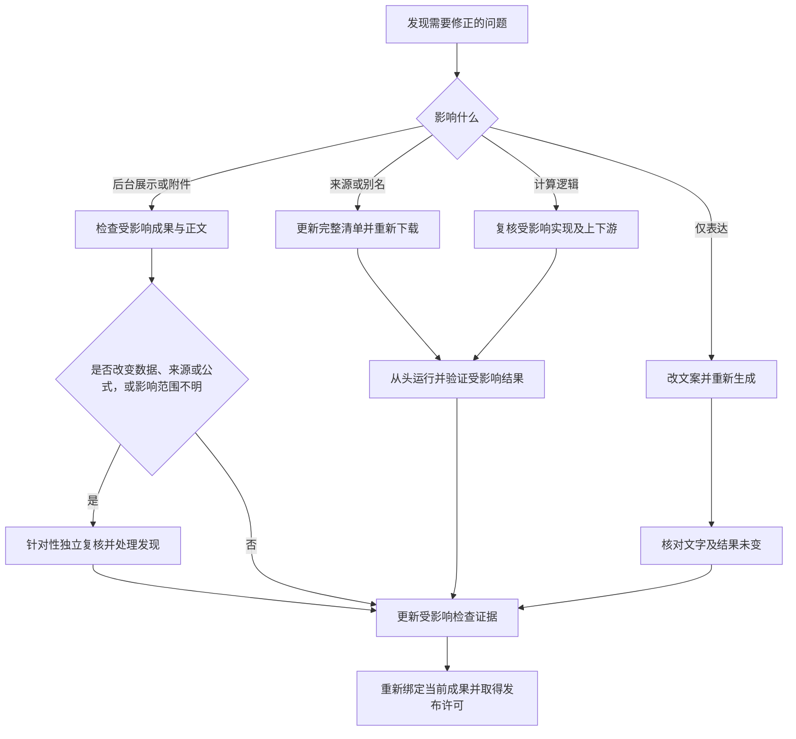

# 执行顺序与复核条件

- 本文件决定什么时候前进、返回或增加复核。
- 各环节负责具体质量标准；[review-roles](review-roles.md)负责角色交接，[成品交接](stages/07-review.md)负责发布许可，[execution-report](execution-report.md)负责如实记录。

## 1. 默认路径：执行主责、程序检查、独立补充审核

### 检查职责

| 要检查什么 | 怎样检查 | 通过能说明什么；失败返回哪里 |
| --- | --- | --- |
| 来源、身份、时期及下载范围 | 来源检查程序比较已登记身份、选择清单、下载字典和 R 输入 | 对应关系一致；事实是否可靠仍须查看原材料。差异返回来源或下载 |
| 前缀、结果类型、单位及分类取值 | 从已确认方案取值，比较代码名、树中单位和导出单元格 | 登记内容与成果一致；不证明前缀选择、单位换算或类别含义正确。差异返回方案、文案或 R |
| 文件、分析数据与字典、顺序、绑定及生成内容 | 现有结果检查比较实际单元格、变量身份、文案和生成物 | 所列比较一致；不证明公式正确。差异返回 R 或生成 |
| 问卷、跳题及分期 | 程序比较已录入证据与文案；执行者对照原卷核实题义和分期 | 登记与展示一致；原卷真实性及翻译准确性由来源复核负责 |
| 公式、缺失处理及分支人数 | 独立 R 复核和第6步实际数据复算 | 实施符合已定方案。路径记录中的人数和勾选仅是登记，不是复算证据 |
| 易读性、说明是否充分 | 执行者按栏目标准完成内容整理；成品稳定后由独立代理补查遗漏 | 不以字数、布尔声明或程序通过替代判断；表达问题回文案，未解决事实回来源方案 |
| 发布与显示 | 交接检查绑定当前成果；固定网站入口核对目标、正文和附件；显示改动做渲染验证 | 只报告实际完成的检查；显示错误返回生成器或网站，写入不明先核实结果 |

程序报告列出实际比较内容和未检查内容。当前文字字段只检查非空、结构及与来源或成果的对应，不设最低字数。历史版本的审核记录仍按其原版本验证。

- 研究问题按第1步双路探索，由主线程比较并合并；明确执行由执行者按规则做好，机械操作走固定入口。
- 完整主题在R预检后保留一次独立实现复核，沿用角色名“公开 R 复核”，检查是否忠实于已确定方案、计算正确性，以及[公开代码的组织与说明](stages/04-public-r.md#4-业务顺序与注释)，不重新完整探索来源。
- 常规程序检查由执行者直接调用，不为运行检查另派代理。成品稳定后复用同一主题的独立审核代理，补查本次内容与呈现；不是再做一次全面研究或 R 前审。
- 下方入口不替代必要的双路探索或R实现复核。

### 阶段输入与条件读取

下表是八阶段的交接入口，不要求局部任务补走前面所有阶段。已有输入与合格结论未变时沿用；具体检查仍由各阶段负责。

| 顺序与规则 | 进入时已有的输入 | 本阶段判断与条件读取 | 通过后交接；失败返回 |
| --- | --- | --- | --- |
| 1 [选题与来源方案](stages/01-source-plan.md) | 用户范围、配置、已有主题索引及未决问题 | 读取证据与文献、所选库来源/身份/时期差异；来源命名在确定清单前读第2步对应节；本地证据、新环境、网站取证分别触发各自入口 | 双路独立结果、主线程合并后的来源、定义、路径、候选取舍及结果关系；事实缺口继续核实，未决研究裁决报告用户 |
| 2 [选择与下载](stages/02-download.md) | 已定方案、完整来源身份与别名 | 读取所选库选择/下载差异；同概念同周期来源要替代或合并时，下载后读来源重叠核对；失败时进入对应找回分支 | 本次完整原始包、raw/codebook、真实取值及必要比较结论；来源问题回第1步，下载故障留本阶段 |
| 3 [纯文案](stages/03-copy.md#执行与读取) | 已定方案、来源证据及下载后必要结论 | 按栏目读取表选择规则和模板；按[定义展示](stages/03-copy.md#定义展示)为每个最终变量保留 Criteria；复核结果关系，不重定方案，再编写所需关系树 | 已定稿文案及已核对的变更影响；格式/表达留本阶段，事实缺口回第1步 |
| 4 [公开 R](stages/04-public-r.md) | 稳定方案、原始数据和文案 | 读取所选库实现差异、正式字典模板；预检后按角色规则进行独立实现复核 | 预检及独立实现复核通过、符合当前合并方案的正式源；实现错误修R，方案变化回第1步并更新文案 |
| 5 [成果生成](stages/05-generate.md) | 稳定源、文案、映射及适配器 | 读取生成接口、正式输出及实际存在内容的显示要求；首次适配或方案探针按本阶段条件执行 | 当前成果及明确退出码的运行日志；输入错误回对应阶段，生成/显示问题留本阶段 |
| 6 [结果验证](stages/06-results.md) | 当前成果、原始数据及独立预期 | 比较既定方案、来源与实现；来源重叠沿用第2步有效结论；额外验收仅按下方触发 | 当前版本、明确检查范围的结果证据；按来源、定义、实现、生成错误分别返回 |
| 7 [成品交接](stages/07-review.md) | 执行者完成的当前产物及程序检查结论 | 独立代理补查本次范围，沿用未变且有效的结论；按角色交接登记实际发现 | 分别汇报执行、程序检查与补充审核；实质问题修正后交接，不把可选建议当阻断 |
| 8 [网站同步](stages/08-website.md) | 已授权成果及当前发布许可 | 读取写入边界的浏览器会话和本阶段固定动作；不加载探索、写作或R规则 | 提交结果、实际耗时和待用户检查状态；许可失效回第7步，提交异常按第8步恢复边界 |

生产记录开始时读取 execution-report；需要角色时读取 review-roles。规则归属索引和维护审计不属于普通主题必读材料。实际任务范围和冲突处理按 SKILL.md，不由本表扩大授权。

每步使用稳定输入。失败只返回出错环节或受影响上游。
命令成功不等于内容通过；不为每条命令创建审核角色。

下面的图只概括返修依赖，不增加步骤或复核。具体范围以下表为准。

### 修正后的复核范围

| 改动 | 返回与核对范围 |
| --- | --- |
| 来源或别名变化 | 按完整新清单重新下载、从头运行，更新受影响证据 |
| 计算逻辑变化 | 复核受影响实现及上下游，从头运行并验证结果 |
| 仅表达变化 | 改文案、重新生成并核对文字及结果未变，不重开探索下载或未变R复核 |
| 仅后台展示或附件变化 | 核对受影响成果与正文；后台若改变数据、来源、公式或影响不能证明，仍须针对性独立复核 |

- 修改任何绑定成果后，重新绑定当前文件并记录影响，旧发布许可失效。
- 输入未变的合格结论可沿用；笔记改动读受影响段落及衔接，不重读无关材料。
- 公开R绑定与角色复查按review-roles，读者结论保留及重新取得许可按第7步；当前失败或待处理结论不能被历史通过覆盖。

### 定义变更影响

- 新主题，或新增、删除、重命名变量、改变对象、周期、问法、组成或缺失处理时，正式R前运行 `check_definition_readability.py init-impact` 并完成 `definition_change_impact.json`。
- 按[填写说明](../../templates/change-impact.md)记录真实变更范围、题组证据及未决问题，不逐栏评价写作质量，不事后根据成品补写。
- 记录未完成、必要题文未进入文案或定义未决时不得生成。

只改表达时使用[文案阶段](stages/03-copy.md#执行与读取)，不写成定义事实变化；方案与R未变则保留原有效R复核。首次预检和R复核不等于每次改字都重做。

### 原始回答冲突

专项扫描仅在用户明确要求时执行，正常执行已发现的矛盾仍须处理。各变量按直接原始题目分别生成；未经用户裁决，不用筛选题优先、金额优先、补零、改缺失、删记录或其它方式强制一致。

- 在现有过程证据保存身份键、周期、题目与回答、来源组、冲突方向和最终保留/裁决结果，不能把派生关系或正式覆盖误写为原始冲突。
- 读者陈述按[Criteria与小book](copy/core.md#5-criteria每个变量怎样得到)的职责。
- 能按直接来源生成时报告后继续；单个变量的生成规则不明、来源不明、重复计入或覆盖顺序未定时，按下述研究判断入口处理。

## 2. 独立验收仅有四个入口

本节只指常规 R 实现复核和成品补充审核以外的专项验收；与本次补充审核范围重合时合并处理，不重复派发。

| 触发情况 | 只复核什么 |
| --- | --- |
| 机器证据缺失、失败、矛盾或执行者不能解释差异 | 冲突字段及生成链 |
| 现有规则和用户裁决不能解决的研究判断 | 返回第1步针对具体问题双路调查、主线程合并；不替用户作尚未明确的研究取舍 |
| 公共核心机制高影响修改且现有测试不足 | 受影响机制及代表性回归 |
| 用户或主任务明确要求独立验收 | 指定范围 |

- 新主题、数据库、变量、编码、mapping或工具变化本身不自动增加验收。
- 原始回答矛盾按上节处理；能按直接来源忠实生成则继续，不自动进入RESULT_REVIEW_REQUIRED。
- 不按任务数量随机抽查，也不让额外验收重跑生产或重复已证明的文件、日志、目录及常规读取检查。

## 普通读者复核

- 普通可读性纳入成品补充审核。只有明确需要不知方案背景的盲读测试时，才启用本入口。
- 角色只看普通读者视图，不查代码或重新调查。已经看过方案和 R 的审核代理不能冒充盲读者。
- 操作见[第7步](stages/07-review.md#按需普通读者复核)。
- 未发起不补记录；一旦发起，未完成、未解决或过期输入仍阻止发布，不能忽略失败继续。

## 4. 状态与入账

- 默认：`GENERATED -> MACHINE_CHECK_PASS -> DELIVERY_CHECK -> PUBLISH_READY -> USER_REVIEW_PENDING -> COMPLETE`。
- 额外验收：`GENERATED -> MACHINE_CHECK_PASS/BLOCKED -> SENT_FOR_VALIDATION -> VALIDATION_PASS -> DELIVERY_CHECK -> PUBLISH_READY -> USER_REVIEW_PENDING -> COMPLETE`。
- machine closure登记机器报告及是否需额外验收；无额外验收写independent_validation_required=false，不另建过程卡。
- MACHINE_CHECK_PASS仅表示机器检查。PUBLISH_READY核对发布条件及已登记审核的有效性；内容判断单独见审核结论，不由程序宣称写作合格。未登记的历史补充审核不补造；纯同步不借机扩展审核范围。USER_REVIEW_PENDING表示已同步待用户阅读；只有用户确认才为COMPLETE。
- 报告的completed不等于用户已验收，不把这些状态记成同一时点。

## 5. 机器产物与写入入口

| 产物 | 状态或有效性 | 生成/验证命令 | 下游 |
| --- | --- | --- | --- |
| definition_change_impact.json | init-impact 创建CHANGE_SCOPE_RECORDED；填写实际变更范围与题组依据，再由check-impact验证，不填自评PASS | check_definition_readability.py init-impact / check-impact | 正式生成 |
| result_check.json | ok=true、scope=complete 且绑定当前文件 | check_definition_output.py --complete；默认位于 --process-dir | 成品交接初始化 |
| readability_audit.json | 新版由init自动绑定文件为ARTIFACTS_BOUND；check核验机械条件，不填自评PASS | check_definition_readability.py init / check | 当前发布许可 |
| reader_comprehension_review.json | 仅实际发起时要求完整独立结论 | init-reader 后填写实际结论，再 check | 已发起的读者复核不得忽略 |
| execution_report.json | running 到 completed / completed_with_issues / failed / stopped | execution_report.py init / stage-start / stage-finish / finish | 执行报告；不代替内容通过 |

变更范围记录实际事实与未决问题；交接绑定由程序生成。两者均不要求写作自评或修改状态来声称合格。历史记录按原版本验证，不改写历史结论。

- 结果检查失败时可用 `check_definition_readability.py preview --note <完整笔记路径>` 只读定位问题，不生成许可。
- 不提供绕过数据、身份或来源失败的accept-known-issue通道。

## 验收范围与沿用结论

任务说明确定修改对象、保留内容和本次重点，不为每一批旧稿设立新的规则流程。验收核对实际差异和未变内容，未涉及的有效研究及计算结论沿用。

使用已有工具的有限范围许可时，检查、网站准备和两次 `verify-ready` 使用同一范围。许可只证明实际核对的部分，不替代完整验收，也不将历史研究和计算重新标为通过。程序报告相关检查已失效时，重新验证其实际范围，不改写旧哈希或补造历史通过。旧局部记录按[第7步](stages/07-review.md#生成发布许可)核对。

材料保留按[执行材料](write-boundaries.md#执行材料)。需要差异对照时，使用真实的修改前文件，候选不能充当原稿。失败返回实际出错环节，不通过新建任务、记录或扩大范围绕过失败。旧成果与网站现稿不同先核对版本，不直接覆盖。
